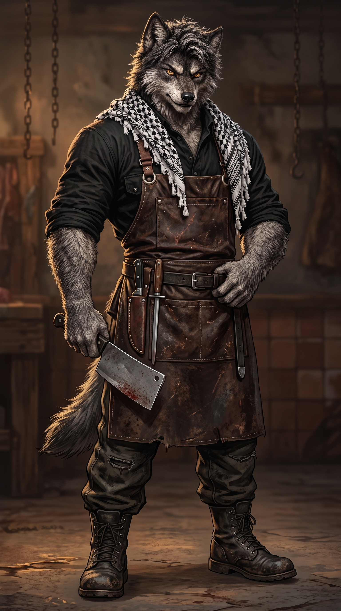

# بەخەی قەساب 3D (Bakha the Butcher 3D Action RPG)

A free-roam First-Person / Third-Person 3D Action RPG built with **Three.js (WebGL + UnrealBloomPass + Custom GLSL Shaders)**, **Bootstrap 5 RTL**, **Web Audio API (Kurdish Daf & Oud Maqam)**, and **Firebase**.

## Key Features
- **Bakha the Alpha Wolf Butcher (3D Rig & Portrait)**: Custom 3D character model featuring Bakha's silver-charcoal wolf fur, glowing golden-amber eyes, black & white Kurdish Jamadani scarf, weathered brown leather butcher apron with brass rings & sheathed knives, and ember-forged Damascus cleaver.
- **Toggleable FPP / TPP**: Press `V` or click the camera button to switch between Third-Person (`TPP`) and First-Person (`FPP`) with a furry wolf forearm viewmodel.
- **Real-Time 3D Combat**: Free-roam with `WASD`, sprint with `Shift`, slash with `Space`, stun with Wolf Howl (`Q`), unleash Blood Rage (`R`), dodge (`C`), and heal (`E`).
- **8-Chapter Central Kurdish (Sorani) Story & 3-Phase Boss Fight**: Defend Barzan Village alongside the Wise Old Man (`پیرەمێردی زانا`) and Village Blacksmith (`ئاسنگەری گوند`), and defeat the **Father of Darkness** across 3 escalating phases.
- **Firebase Cloud Saves & Global Leaderboard**: Configured in `js/firebase-config.js` and ready for GitHub Pages deployment.
